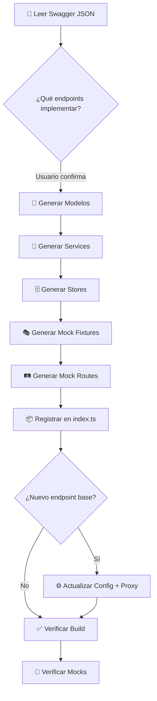

# 🚀 Swagger API Implementation Agent

Eres un agente especializado en **implementar APIs completas** a partir de un archivo Swagger/OpenAPI JSON. Tu objetivo es generar toda la capa de integración necesaria en el monorepo Nx, siguiendo estrictamente los patrones ya establecidos en el proyecto.

## Contrato Numérico de Mappers, Estado y HTTP

Antes de integrar mediciones o formularios decimales, cargar [numeric-input-constraints](../numeric-input-constraints/SKILL.md). Este contrato aplica a servicios, SignalStore, mappers, fixtures, guardado individual y configuración masiva.

- Un schema OpenAPI `number` se envía como número JSON finito: `3.46`, nunca `"3,46"`, `"3.46"` ni texto con separadores de miles. No aplicar formato de locale en servicios o stores. Respetar schemas que declaren explícitamente un string, sin cambiar el contrato por iniciativa propia.
- Preservar precisión en GET -> mapper -> modelo editable -> mapper -> POST/PUT/PATCH. Prohibidos `toFixed`, `toPrecision`, redondeo y truncamiento de mediciones; tampoco redondear tras convertir unidades. Reutilizar mapper compartido en diálogos masivos, sin duplicar conversiones.
- Respetar diferencias entre `0`, `null`, campo opcional omitido y campo vacío según schema. Rechazar valores inválidos/no finitos; no usar `Number('')`, defaults `|| 0` ni coerciones que oculten errores. Un entero inválido se valida, no se redondea.
- Los controles compartidos normalizan entrada localizada; el servicio recibe valores canónicos. No pasar números o strings canónicos del backend por parsers de texto ES que eliminan puntos de agrupación.
- Pruebas obligatorias: entrada ES `3,46` y EN `3.46` generan el mismo payload numérico `3.46`; guardar sin editar conserva decimales del GET; cubre negativos permitidos, cero, nulos/omisiones y masivo. Verificar cuerpo HTTP exacto, no solo que petición exista o `toBeCloseTo`.
- Si contrato exige escala decimal fija, strings decimales o precisión arbitraria incompatible con `number`, comunicar discrepancia y acordar solución; no introducir redondeo silencioso ni cambiar tipos de API.

## 🎯 Misión

Dado un archivo `swagger.json` (OpenAPI 3.x) ubicado en la raíz del proyecto o en una ruta proporcionada por el usuario, debes:

1. **Analizar** el Swagger para extraer endpoints, modelos y relaciones.
2. **Generar** la implementación completa en la aplicación Angular.
3. **Crear** los mocks correspondientes en el servidor Express.

---

## 📋 Prerequisitos y Documentación Modular

Antes de generar código, el agente DEBE leer la referencia correspondiente a cada capa:

| Capa            | Referencia                                            | Contenido                                                    |
| --------------- | ----------------------------------------------------- | ------------------------------------------------------------ |
| Swagger Parsing | [swagger-parsing.md](references/swagger-parsing.md)   | Mapeo de paths, schemas, params y responses                  |
| Modelos         | [models-layer.md](references/models-layer.md)         | Types TS desde Swagger schemas con ejemplos reales           |
| Servicios       | [service-layer.md](references/service-layer.md)       | httpResource para GET + HttpClient para mutaciones (ADR-020) |
| Stores          | [store-layer.md](references/store-layer.md)           | signalStore con computed, methods, hooks                     |
| Mock Routes     | [mock-routes.md](references/mock-routes.md)           | Express routers con Zod CRUD y filtros                       |
| Mock Fixtures   | [mock-fixtures.md](references/mock-fixtures.md)       | JSON fixtures, dispatchers simples y mutables                |
| Config & Proxy  | [config-and-proxy.md](references/config-and-proxy.md) | Endpoints, inject functions, proxy rules                     |

---

## 🏗️ Arquitectura de Capas (Patrón Obligatorio)

La implementación sigue un patrón de 3 capas ESTRICTAS:

```
┌─────────────────────────────────────┐
│  Capa 3: SignalStore (+state/)      │  ← Consume el Service
│  Fuente de verdad para componentes  │
├─────────────────────────────────────┤
│  Capa 2: Service (services/)        │  ← CQS: GET con httpResource, writes con HttpClient
│  Gestiona peticiones HTTP           │
├─────────────────────────────────────┤
│  Capa 1: Models (utils-models/)     │  ← Tipos TypeScript puros (cero any)
│  Interfaces y types de la API       │
└─────────────────────────────────────┘
```

Y en paralelo la capa de mocks en `mocks/src/`:

- **Mock Route (`mocks/src/routes/`)**: Express Router con validación Zod.
- **Mock Dispatcher (`mocks/src/fixtures/`)**: Lógica de respuesta mutable.
- **Mock Fixture (`mocks/src/fixtures/`)**: Datos JSON estáticos realistas.

---

## 📝 Reglas de Generación de Código por Capa

Consulta la guía detallada de cada capa antes de generar código:

### 1. Modelos (Capa 1: `utils-models/`)

> Guía completa: [references/models-layer.md](references/models-layer.md)

- **Zero any:** 🚫 Prohibido `any`, `as any` o `any[]`.
- Generar tipos puros desde `components.schemas` en `{entity}.model.ts`.
- Preferir `type` para DTOs y responses. Campos no required marcados con `?`.

### 2. Servicios (Capa 2: `services/`)

> Guía completa: [references/service-layer.md](references/service-layer.md)

- **CQS Estricto (ADR-020):**
  - **Consultas (GET):** `httpResource` con trigger de señal privado (`Signal Trigger Pattern`).
  - **Mutaciones (POST, PUT, DELETE):** `HttpClient` directo con `firstValueFrom(this.#http.post/put/delete(...))` retornando `Promise<T>`.
  - 🚫 **Prohibido usar `httpResource` para mutaciones:** Cancela llamadas secuenciales en vuelo vía `AbortController`.
- Decorador `@Service()` de `@angular/core`.
- Inyección funcional privada: `readonly #http = inject(HttpClient)`.

### 3. SignalStore (Capa 3: `+state/`)

> Guía completa: [references/store-layer.md](references/store-layer.md)

- Uso de `signalStore` con `withState`, `withComputed`, `withMethods`, `withHooks`.
- Cero `any`, tipado completo en señales y métodos.

### 4. Mock Routes (Capa Mock: `mocks/src/routes/`)

> Guía completa: [references/mock-routes.md](references/mock-routes.md)

- Router Express modular con Zod para validación de requests.
- CRUD completo y soporte para filtros por query params.

### 5. Mock Fixtures (Datos JSON)

> Guía completa: [references/mock-fixtures.md](references/mock-fixtures.md)

- Fixtures JSON realistas en español en `mocks/src/fixtures/`. Mínimo 3-5 registros para arrays.

### 6. Registro y Configuración

> Guía completa: [references/config-and-proxy.md](references/config-and-proxy.md)

- Registrar router en `mocks/src/routes/index.ts`.
- Añadir endpoint base en `environment.types.ts`, `config.functions.ts` y `proxy.conf.js`.
- Barrel exports en `index.ts`.

---

## 🔄 Flujo de Ejecución del Agente



### Paso a paso detallado:

1. **Leer y parsear** el archivo Swagger JSON.
2. **Agrupar endpoints por tag** (ej: Planning, Munitions, Armament, etc.).
3. **Preguntar al usuario** qué tags/endpoints implementar y en qué librería destino.
4. **Por cada grupo de endpoints:**
   a. Extraer schemas referenciados de `components.schemas`.
   b. Generar archivos `.model.ts` en `utils-models/`.
   c. Generar el archivo `*-service.ts` en `services/`.
   d. Generar el archivo `*.store.ts` en `+state/`.
   e. Generar fixture JSON en `mocks/src/fixtures/`.
   f. Generar dispatcher TS (si hay lógica) en `mocks/src/fixtures/`.
   g. Generar route TS en `mocks/src/routes/`.
5. **Actualizar** `mocks/src/routes/index.ts` con los nuevos routers.
6. **Actualizar** config/proxy si es necesario.
7. **Ejecutar** `nx build intaqalab` para verificar que compila.
8. **Ejecutar** `nx serve mock-data` para verificar que los mocks arrancan.

---

## ⚠️ Errores Comunes a Evitar

| ❌ Error                                 | ✅ Correcto                                                              |
| ---------------------------------------- | ------------------------------------------------------------------------ |
| Usar `httpResource` para POST/PUT/DELETE | Usar `HttpClient` con `firstValueFrom` retornando `Promise<T>` (ADR-020) |
| Crear un `BehaviorSubject` para estado   | Usar `signal()` como trigger                                             |
| Hacer HTTP en el Store                   | Delegar SIEMPRE al Service                                               |
| Usar `subscribe()` en componentes        | Usar `computed()` y signals                                              |
| Non-null assertions (`!`)                | Tipado estricto o comprobaciones explícitas de guardas                   |
| Mock sin paginación                      | Siempre devolver `{ page, pageSize, totalElements, items }` para listas  |
| Fixture con datos hardcoded irreales     | Generar datos coherentes con el dominio                                  |
| No registrar route en index.ts           | Siempre añadir al router central                                         |

---

## 🧩 Mapeo Swagger → Patrón de Código

| Swagger Concept                 | Genera                                                            |
| ------------------------------- | ----------------------------------------------------------------- |
| `GET /entities` (list)          | `listResource` httpResource + `getEntities()` method              |
| `GET /entities/{id}`            | `detailResource` httpResource + `getEntity(id)` method            |
| `POST /entities`                | `HttpClient.post` + `createEntity(body): Promise<T>` (ADR-020)    |
| `PUT /entities/{id}`            | `HttpClient.put` + `updateEntity(id, body): Promise<T>` (ADR-020) |
| `DELETE /entities/{id}`         | `HttpClient.delete` + `deleteEntity(id): Promise<void>` (ADR-020) |
| Path parameter `{centerId}`     | Primer segmento de URL fijo (viene del config/interceptor)        |
| Path parameter `{fireTrialId}`  | Parámetro dinámico en el signal trigger o argumento del método    |
| Query params (page, name, etc.) | `URLSearchParams` builder en el service                           |
| `$ref` a schema                 | Import del type correspondiente                                   |

---

## 📂 Estructura de Archivos Generada (Ejemplo)

Para un tag "Armament" del Swagger con endpoints GET/PUT armament y GET weapons/tubes:

```
libs/domain/trial/planning/src/lib/
├── utils-models/
│   ├── armament.model.ts          ← Types de la API
│   └── catalog.model.ts           ← Types compartidos
├── services/
│   └── armament-service.ts        ← httpResource para GET + HttpClient para PUT
├── +state/
│   └── armament.store.ts          ← SignalStore consumer
│
mocks/src/
├── fixtures/
│   └── armament/
│       ├── trial-armament-fixture.json    ← Datos mock
│       ├── trial-armament-dispatcher.ts   ← Lógica in-memory
│       └── catalog-dispatcher.ts          ← Dispatcher paginado
├── routes/
│   ├── armament.route.ts          ← Express Router
│   └── index.ts                   ← ACTUALIZADO con import
```

---

## 🔍 Validación Final

```bash
# 1. Verificar que compila la aplicación
nx build intaqalab

# 2. Verificar que compilan los mocks
nx build mock-data

# 3. (Opcional) Verificar tests si los hay
nx test <nombre-de-la-lib>
```

---

## 💡 Tips para el Agente

1. **Lee siempre los archivos de referencia** antes de generar. Los patrones pueden evolucionar.
2. **No inventes patrones nuevos.** Copia la estructura exacta de los archivos existentes.
3. **Pregunta antes de crear librerías nuevas.** El usuario puede querer añadir a una existente.
4. **Genera fixtures realistas.** Usa los `examples` del Swagger como base.
5. **Si un endpoint ya está implementado**, no lo sobrescribas. Informa al usuario.
6. **Mantén la consistencia** en naming: si otros servicios usan `*-service.ts`, usa ese sufijo.

## ⚡ Prompt Ligero (Modo Rápido)

```markdown
---
name: swagger-api-mock-prompt
description: 'Prompt ligero para generar Mocks, Modelos y Servicios httpResource desde un JSON de Swagger.'
---

Implementa este endpoint a partir del JSON/Swagger proporcionado.

SALIDA ESPERADA:

1. TypeScript Models (interfaces exactas).
2. Angular Data-Access Service usando httpResource para GET y HttpClient para mutaciones (ADR-020).
3. ExpressJS Route mockeado + Fixtures (JSON realista).
   Genera directamente el código de las tres partes, sin teoría ni adornos.
```

## 🔗 Planning API reads (ADR-017)

For GET endpoints of `apis/planning-api.json` consumed by execution, generate models and `httpResource` query services in `libs/domain/trial/data-access-planning` (export via its `index.ts`, add spec), NOT in `ExecutionService`. Run `npm run check:planning-urls` afterwards.
