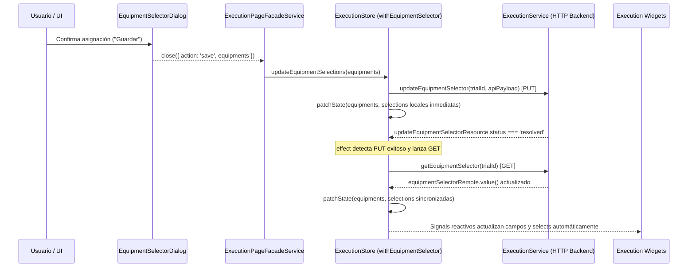

# Widget System Documentation

## 🎯 Overview

Sistema centralizado de gestión de widgets para el grid de ejecución. Incluye:

- **Enum centralizado** de IDs de widgets (`WidgetId`)
- **Registro de configuración** con metadatos de cada widget
- **Persistencia en backend** de preferencias de usuario/rol
- **Sincronización automática** entre estado local y servidor

---

## 📦 Estructura

### Modelos

```
models/
├── widget-id.enum.ts              # Enum WidgetId (única fuente de verdad)
├── widget-registry.ts              # Configuración de cada widget
├── execution-grid.models.ts        # Tipos del grid (usar WidgetId)
└── index.ts                        # Exports centralizados
```

### Servicios & Stores

Las preferencias se gestionan de forma centralizada en `ExecutionStore` (`withGeneralData`) y `ExecutionService` a través de los endpoints oficiales:

- `/execution/preferences/roles/{roleName}`
- `/execution/preferences/users/{username}`

````

---

## 🚀 Quick Start

### Usar WidgetId en componentes

```typescript
import { WidgetId } from '@intaqalab/domain-trial-execution';

// En el grid switch:
@switch (widget.type) {
  @case (WidgetId.JLT_MAO) { <inta-jlt-mao /> }
  @case (WidgetId.EXECUTION_PREP_TECH) {
    <inta-execution-prep-tech-widget [techProfile]="widget.techProfile" />
  }
}
````

### Cargar preferencias guardadas

```typescript
import { WidgetPreferencesStore } from '@intaqalab/domain-trial-execution';

export class ExecutionComponent {
  readonly preferencesStore = inject(WidgetPreferencesStore);

  ngOnInit() {
    // Cargar preferencias del backend
    await this.preferencesStore.loadPreferences(centerId, fireTrialId);

    // Acceder a widgets guardados
    const widgets = this.preferencesStore.getAllWidgets();
  }
}
```

### Guardar cambios de widgets

```typescript
// Cuando el usuario reordena/añade/remueve widgets:
await this.preferencesStore.savePreferences(
  this.widgetStateService.placedWidgets().map((w) => ({
    widgetId: w.type,
    position: w.position,
    width: w.width,
    height: w.height,
    techProfile: w.techProfile,
  })),
);
```

---

## 📋 Widget Registry

Todos los widgets están registrados en `WIDGET_REGISTRY`:

```typescript
export const WIDGET_REGISTRY: Record<WidgetId, WidgetConfig> = {
  [WidgetId.EXECUTION_PREP_JLT]: {
    id: WidgetId.EXECUTION_PREP_JLT,
    titleKey: 'TRIAL_EXECUTION.WIDGETS.EXEC_PREP_JLT.TITLE',
    descriptionKey: 'TRIAL_EXECUTION.WIDGETS.EXEC_PREP_JLT.DESCRIPTION',
    defaultWidth: 1,
    hasForm: true,
  },
  // ... más widgets
};
```

**Acceder a configuración de un widget**:

```typescript
import { getWidgetConfig } from '@intaqalab/domain-trial-execution';

const config = getWidgetConfig(WidgetId.EXECUTION_PREP_JLT);
console.log(config.titleKey); // "TRIAL_EXECUTION.WIDGETS.EXEC_PREP_JLT.TITLE"
```

---

## 💾 API Endpoints

### General (usuario actual)

```http
GET    /{centerId}/fire-trials/{fireTrialId}/execution/preferences
PUT    /{centerId}/fire-trials/{fireTrialId}/execution/preferences
```

### Por Rol

```http
GET    /{centerId}/fire-trials/{fireTrialId}/execution/preferences/roles/{roleName}
PUT    /{centerId}/fire-trials/{fireTrialId}/execution/preferences/roles/{roleName}
```

### Por Usuario

```http
GET    /{centerId}/fire-trials/{fireTrialId}/execution/preferences/users/{username}
PUT    /{centerId}/fire-trials/{fireTrialId}/execution/preferences/users/{username}
```

### Payload de petición

```json
{
  "widgets": [
    {
      "widgetId": "jlt-mao",
      "position": { "row": 1, "col": 1 },
      "width": 1,
      "height": 1
    },
    {
      "widgetId": "execution-prep-tech",
      "position": { "row": 1, "col": 2 },
      "width": 2,
      "height": 1,
      "techProfile": "velocidades"
    }
  ]
}
```

### Respuesta del servidor

```json
{
  "success": true,
  "message": "Preferencias guardadas correctamente",
  "preferences": {
    "centerId": "center-001",
    "fireTrialId": "trial-001",
    "widgets": [...],
    "createdAt": "2026-06-11T10:00:00Z",
    "updatedAt": "2026-06-11T10:00:00Z"
  }
}
```

---

## 🔧 Añadir un nuevo widget

### 1. Añadir ID al enum

**File**: `models/widget-id.enum.ts`

```typescript
export enum WidgetId {
  // ...
  MY_NEW_WIDGET = 'my-new-widget',
}
```

### 2. Registrar en el registry

**File**: `models/widget-registry.ts`

```typescript
[WidgetId.MY_NEW_WIDGET]: {
  id: WidgetId.MY_NEW_WIDGET,
  titleKey: 'TRIAL_EXECUTION.WIDGETS.MY_NEW_WIDGET.TITLE',
  descriptionKey: 'TRIAL_EXECUTION.WIDGETS.MY_NEW_WIDGET.DESCRIPTION',
  defaultWidth: 2,
  hasForm: true, // si tiene formulario con cambios
},
```

### 3. Actualizar el switch en execution-grid.ts

```typescript
@case (WidgetId.MY_NEW_WIDGET) {
  <inta-my-new-widget [widgetId]="widget.id" />
}
```

### 4. Añadir traducciones

**Files**: `es.json`, `en.json`, `de.json`

```json
"WIDGETS": {
  "MY_NEW_WIDGET": {
    "TITLE": "Mi Nuevo Widget",
    "DESCRIPTION": "Descripción del widget"
  }
}
```

---

## ✅ Type Safety

### Type Guard

```typescript
import { isValidWidgetId } from '@intaqalab/domain-trial-execution';

if (isValidWidgetId(someValue)) {
  // someValue es un WidgetId válido
}
```

### Acceder a valores del enum

```typescript
import { ALL_WIDGET_IDS } from '@intaqalab/domain-trial-execution';

// Iterar sobre todos los widgets
ALL_WIDGET_IDS.forEach((id) => {
  const config = getWidgetConfig(id);
  console.log(config.titleKey);
});
```

---

## 🔄 Flujo de sincronización

```
┌─────────────────────────────────────────┐
│  Usuario interactúa con grid            │
│  (añade/remueve/reordena widgets)       │
└──────────────┬──────────────────────────┘
               │
               ▼
┌─────────────────────────────────────────┐
│  WidgetStateService actualiza en memoria│
│  (PlacedWidget[] signal)                │
└──────────────┬──────────────────────────┘
               │
               ▼
┌─────────────────────────────────────────┐
│  Usuario hace clic "Guardar"            │
└──────────────┬──────────────────────────┘
               │
               ▼
┌─────────────────────────────────────────┐
│  preferencesStore.savePreferences()     │
│  - Convierte PlacedWidget[] a           │
│    SavedWidgetConfig[]                  │
└──────────────┬──────────────────────────┘
               │
               ▼
┌─────────────────────────────────────────┐
│  WidgetPreferencesService.               │
│  upsertWidgetPreferences()              │
│  - HTTP PUT al backend                  │
└──────────────┬──────────────────────────┘
               │
               ▼
┌─────────────────────────────────────────┐
│  Backend persiste en DB                 │
│  y retorna WidgetPreferences            │
└──────────────┬──────────────────────────┘
               │
               ▼
┌─────────────────────────────────────────┐
│  preferencesStore actualiza              │
│  su estado signal                       │
└─────────────────────────────────────────┘
```

---

## 🐛 Debugging

### Verificar widgets registrados

```typescript
import { ALL_WIDGET_IDS, WIDGET_REGISTRY } from '@intaqalab/domain-trial-execution';

console.log('Total widgets:', ALL_WIDGET_IDS.length);
console.log('Registry:', WIDGET_REGISTRY);
```

### Verificar estado de preferencias

```typescript
import { ExecutionStore } from '@intaqalab/domain-trial-execution';

const store = inject(ExecutionStore);
console.log('Preferences user:', store.preferencesByUser());
console.log('Preferences role:', store.preferencesByRole());
```

### Validar IDs

```typescript
import { isValidWidgetId } from '@intaqalab/domain-trial-execution';

const testId = 'shot';
if (isValidWidgetId(testId)) {
  console.log('✓ ID válido:', testId);
} else {
  console.log('✗ ID inválido:', testId);
}
```

---

## 📚 References

- [WidgetId Enum](./models/widget-id.enum.ts)
- [Widget Registry](./models/widget-registry.ts)
- [Execution Grid Models](./models/execution-grid.models.ts)
- [Execution Store](../../+state/execution.store.ts)
- [Execution Service](../../services/execution.service.ts)

## Patrón de diálogos de transición

Las transiciones de estado (pausar, interrumpir, cancelar) se ejecutan directamente realizando la petición HTTP desde el propio diálogo (ej. \`PauseExecutionDialogComponent\`).
El diálogo se cierra solo cuando el resource HTTP pasa al estado \`resolved\`.
Por este motivo, la fachada (\`ExecutionFacade\` o \`ExecutionStore\`) NO necesita ni debe llamar a los endpoints de transición directamente. El simple acto de confirmar el diálogo completa la operación y el store recarga el estado dinámicamente al recibir un estado \`resolved\` en sus signals internos.

---

## 🛑 Widgets Autónomos (Exclusión de refresco por `updatedAt`)

Por defecto, el polling de `GET /execution/state` en `withGeneralData` (`general-data.feature.ts`) compara `state.updatedAt` y, cuando detecta un cambio, refresca los recursos globales de seguimiento/progreso y actualiza `activeSerieId` y `activeShotId`.

Cuando un widget debe ser **autónomo** (gestionar su propia carga inicial sin re-ejecutar peticiones ni alterar su estado local ante cambios de `updatedAt`):

1. **Estado y métodos en `ExecutionStore` (`withGeneralData`)**:
   - `autonomousWidgets: Set<WidgetId>` (inicializado con `DEFAULT_AUTONOMOUS_WIDGETS = [WidgetId.SEGUIMIENTO]`).
   - `registerAutonomousWidget(widgetId: WidgetId): void`
   - `unregisterAutonomousWidget(widgetId: WidgetId): void`
   - `isWidgetAutonomous(widgetId: WidgetId): boolean`
2. **Declaración en el componente (`BaseFormWidgetComponent`)**:
   - Establecer `protected override readonly autonomousWidgetType = WidgetId.SEGUIMIENTO;` en el widget.
   - `BaseFormWidgetComponent` registra el widget en `ngOnInit()` y lo desregistra en `ngOnDestroy()`.
3. **Guard en efectos de sincronización**:
   - Antes de lanzar refrescos dependientes de `updatedAt`, comprobar `!untracked(() => store.isWidgetAutonomous(WidgetId.<ID>))`.

---

## ⚙️ Asignación de Equipos y Consumo en Widgets (Selector de Equipos)

### 🎯 Visión General (Funcional 4.3)

El módulo de **Asignación de Equipos** permite vincular los equipos de medida de Calibry requeridos por la planificación a las series y disparos del ensayo. Los equipos asignados alimentan directamente los desplegables y campos de selección de los widgets durante la ejecución.

### 📐 Arquitectura de Dos Capas

1. **Capa Diálogo (`EquipmentSelectorDialog` + `EquipmentSelectorStore`):**
   - Store local de ciclo de vida efímero que gestiona la edición tabular por familias (tags).
   - Inyecta `EquipmentPlanningService` para resolver medidas planificadas (`GET /measures`) y catálogo.
   - **Regla de visibilidad dinámica:** Sólo se muestran las etiquetas (tags) que cumplen simultáneamente dos criterios:
     - Autorizadas según el rol de la unidad técnica del usuario (`resolveVisibleEquipmentTags`).
     - Planificadas activamente para el ensayo (`enabledTagIds`).
     - **Las etiquetas no planificadas o no autorizadas no se muestran en pantalla** (cero chips deshabilitados).
   - Emite `{ action: 'save', equipments: EquipmentMagnitudeSelectionGroup[] }` al confirmar.

2. **Capa Global (`ExecutionStore` + `withEquipmentSelector`):**
   - Mantiene el estado persistido de asignaciones de equipos a nivel de ensayo.
   - Orquesta la mutación vía `PUT /equipment-selection` y sincroniza reactivamente vía `GET /equipment-selection`.

### 🔄 Flujo de Persistencia y Sincronización (PUT / GET)



### 🧩 Consumo en Widgets (`libs/domain/trial/execution/src/lib/execution/widgets`)

Los widgets inyectan `ExecutionStore` para acceder de forma reactiva a las asignaciones de equipos:

```typescript
import { Component, computed, inject } from '@angular/core';

import { ExecutionStore } from '../../../+state/execution.store';
import { EquipmentTypeEnum } from '../../models/equipment.models';

@Component({
  selector: 'inta-my-execution-widget',
  template: `
    @for (equipo of activeShotEquipments(); track equipo.itemId) {
      <span>{{ equipo.itemId }}</span>
    }
  `,
})
export class MyExecutionWidget {
  readonly #store = inject(ExecutionStore);

  // 1. Asignaciones aplanadas completas
  readonly allSelections = computed(() => this.#store.equipmentSelector().selections);

  // 2. Asignaciones agrupadas por tag
  readonly groupedEquipments = computed(() => this.#store.equipmentSelector().equipments);

  // 3. Filtrar equipos asignados para la serie y disparo actualmente activos
  readonly activeShotEquipments = computed(() => {
    const activeSerieId = this.#store.activeSerieId();
    const activeShotId = this.#store.activeShotId();
    if (!activeSerieId || !activeShotId) return [];

    return this.allSelections().filter(
      (sel) => sel.series.includes(activeSerieId) && sel.disparos.includes(activeShotId),
    );
  });

  // 4. Filtrar por categoría de instrumento (ej. Cámaras climáticas, Sensores, etc.)
  readonly climaticChambers = computed(() =>
    this.allSelections().filter((sel) => sel.categoryId === EquipmentTypeEnum.CLIMATIC_CHAMBER),
  );
}
```

### 📚 Señales expuestas por `ExecutionStore` (`withEquipmentSelector`)

| Señal                            | Tipo                                     | Descripción                                                                                              |
| :------------------------------- | :--------------------------------------- | :------------------------------------------------------------------------------------------------------- |
| `equipmentSelector().equipments` | `EquipmentMagnitudeSelectionGroup[]`     | Asignaciones agrupadas por familia de magnitud (`id: EquipmentMagnitudeTagEnum`).                        |
| `equipmentSelector().selections` | `EquipmentItemSelection[]`               | Lista aplanada de asignaciones con `itemId`, `categoryId`, `series`, `disparos`, `magnitude`, `channel`. |
| `equipmentSelectorRemote()`      | `EquipmentSelectionApiList \| undefined` | Datos crudos del backend provenientes de `equipmentSelectorResource` (`httpResource`).                   |
| `isLoadingEquipmentSelector()`   | `boolean`                                | Indica si el GET de asignaciones de equipos está en progreso.                                            |
| `isUpdatingEquipmentSelector()`  | `boolean`                                | Indica si el PUT de asignaciones de equipos está en progreso.                                            |
